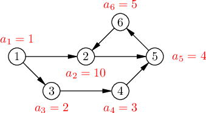

# 20261124 ECUT 计协第七次训练赛 · 10 题题面（全中文）

> **时间**：2026-11-24 14:00 – 17:00 CST　**题数**：10（A–J）
>
> 题面取自洛谷镜像题库（洛谷自带中文翻译），已删掉译者署名、修复机翻里断裂的公式和格式说明，并在必要处改写病句。


## 题目一览

| 题号 | 中文题目名 | 原名 | 来源 | 通过/提交 | 洛谷镜像 |
|:---:|---|---|---|:---:|---|
| A | 前后添字符 | Prepend and Append | Codeforces 1791C | 24/34 | [CF1791C](https://www.luogu.com.cn/problem/CF1791C) |
| B | 平衡的回合 | Balanced Round | Codeforces 1850D | 21/32 | [CF1850D](https://www.luogu.com.cn/problem/CF1850D) |
| C | 单词游戏 | Word Game | Codeforces 1722C | 16/18 | [CF1722C](https://www.luogu.com.cn/problem/CF1722C) |
| D | 正负数 | Negatives and Positives | Codeforces 1791E | 16/22 | [CF1791E](https://www.luogu.com.cn/problem/CF1791E) |
| E | 地毯 | — | 洛谷 P3397 | 20/27 | [P3397](https://www.luogu.com.cn/problem/P3397) |
| F | 采药 | NOIP 2005 普及组 | 洛谷 P1048 | 11/17 | [P1048](https://www.luogu.com.cn/problem/P1048) |
| G | 学语言 | Learning Languages | Codeforces 277A | 4/5 | [CF277A](https://www.luogu.com.cn/problem/CF277A) |
| H | 最大中位数 | Maximum Median | Codeforces 1201C | 7/7 | [CF1201C](https://www.luogu.com.cn/problem/CF1201C) |
| I | 数组等化 | Equalize the Array | Codeforces 1490F | 5/10 | [CF1490F](https://www.luogu.com.cn/problem/CF1490F) |
| J | 向图中掷一枚硬币… | Toss a Coin to Your Graph... | Codeforces 1679D | 4/6 | [CF1679D](https://www.luogu.com.cn/problem/CF1679D) |

---

## A. 前后添字符（Prepend and Append）

**来源**：Codeforces 1791C ｜ **时间限制**：1 s ｜ **内存限制**：256 MB

**链接**：[洛谷（中文）](https://www.luogu.com.cn/problem/CF1791C) ｜ [原题](https://codeforces.com/problemset/problem/1791/C)

### 题目描述

Timur 最初有一个二进制字符串 $s$（长度可能为 $0$）。他进行了若干次（可能为零次）如下操作：

- 在字符串的一端添加一个 $\texttt{0}$，在另一端添加一个 $\texttt{1}$。例如，从字符串 $\texttt{1011}$ 出发，你可以得到 $\color{red}{\texttt{0}}\texttt{1011}\color{red}{\texttt{1}}$ 或 $\color{red}{\texttt{1}}\texttt{1011}\color{red}{\texttt{0}}$。

现在给你 Timur 最终得到的字符串。请你求出他最初可能拥有的字符串的最短长度是多少。

$^{\dagger}$ 二进制字符串是指仅由 $\texttt{0}$ 或 $\texttt{1}$ 组成的字符串（可以为空串）。

### 输入格式

输入的第一行包含一个整数 $t$（$1 \leq t \leq 100$），表示测试用例的数量。

每个测试用例的第一行包含一个整数 $n$（$1 \leq n \leq 2000$），表示 Timur 最终字符串的长度。

每个测试用例的第二行包含一个长度为 $n$ 的字符串 $s$，仅由字符 $\texttt{0}$ 或 $\texttt{1}$ 组成，表示最终的字符串。

### 输出格式

对于每个测试用例，输出一个非负整数，表示 Timur 最初可能拥有的字符串的最短长度。注意，Timur 最初的字符串可能为空，此时应输出 $0$。

### 样例

**输入**

```text
9
3
100
4
0111
5
10101
6
101010
7
1010110
1
1
2
10
2
11
10
1011011010
```

**输出**

```text
1
2
5
0
3
1
0
2
4
```

### 说明/提示

在第一个测试用例中，Timur 最短可能的初始字符串是 $\texttt{0}$，他进行了如下操作：$\texttt{0} \to \color{red}{\texttt{1}}\texttt{0}\color{red}{\texttt{0}}$。

在第二个测试用例中，Timur 最短可能的初始字符串是 $\texttt{11}$，他进行了如下操作：$\texttt{11} \to \color{red}{\texttt{0}}\texttt{11}\color{red}{\texttt{1}}$。

在第三个测试用例中，Timur 最短可能的初始字符串是 $\texttt{10101}$，他没有进行任何操作。

在第四个测试用例中，Timur 最短可能的初始字符串是空串（记作 $\varepsilon$），他进行了如下操作：$\varepsilon \to \color{red}{\texttt{1}}\texttt{}\color{red}{\texttt{0}} \to \color{red}{\texttt{0}}\texttt{10}\color{red}{\texttt{1}} \to \color{red}{\texttt{1}}\texttt{0101}\color{red}{\texttt{0}}$。

在第五个测试用例中，Timur 最短可能的初始字符串是 $\texttt{101}$，他进行了如下操作：$\texttt{101} \to \color{red}{\texttt{0}}\texttt{101}\color{red}{\texttt{1}} \to \color{red}{\texttt{1}}\texttt{01011}\color{red}{\texttt{0}}$。

---

## B. 平衡的回合（Balanced Round）

**来源**：Codeforces 1850D ｜ **时间限制**：2 s ｜ **内存限制**：256 MB

**链接**：[洛谷（中文）](https://www.luogu.com.cn/problem/CF1850D) ｜ [原题](https://codeforces.com/problemset/problem/1850/D)

### 题目描述

你是codeforces round的出题人，现在你将设置n个问题，第i个问题的难度是ai。你将进行以下操作步骤：
1.	从题单中移除一部分题目（移除的题目的数量可能是0）
2.	按你想要的任何顺序重新排列剩余的问题

当且仅当任意两道连续的题目的难度之差的绝对值最多为k时（即绝对值小于等于k），这一回合（round）会被认为是平衡的。

你最少需要移除多少道题目，才能使问题的安排是平衡的？

### 输入格式

第一行包含一个整数t(1≤t≤1000)，代表样例的数量

对于每个样例的第一行包含两个正整数n(1≤n≤2⋅10^5)和k(1≤k≤10^9)，n代表初始问题的数量，k代表连续的两个问题难度之差的绝对值的最大值

对于每个样例的第二行包含n个用空格隔开的整数ai(1≤ai≤10^9)，代表每个问题的难度

请注意，所有测试用例的n不超过2⋅10^5

### 输出格式

对于每个测试用例，输出一个正整数，代表你为了使问题的安排平衡所最少需要移除的问题的数量

### 样例

**输入**

```text
7
5 1
1 2 4 5 6
1 2
10
8 3
17 3 1 20 12 5 17 12
4 2
2 4 6 8
5 3
2 3 19 10 8
3 4
1 10 5
8 1
8 3 1 4 5 10 7 3
```

**输出**

```text
2
0
5
0
3
1
4
```

### 说明/提示

对于第一个样例，删掉前两道题后剩下难度为 $4,5,6$ 的三道题：$|5-4|=1\le 1$，$|6-5|=1\le 1$，满足条件。

对于第二个样例，只保留难度为 $10$ 的那一道题，单独一道题也算平衡。

---

## C. 单词游戏（Word Game）

**来源**：Codeforces 1722C ｜ **时间限制**：1 s ｜ **内存限制**：256 MB

**链接**：[洛谷（中文）](https://www.luogu.com.cn/problem/CF1722C) ｜ [原题](https://codeforces.com/problemset/problem/1722/C)

### 题目描述

三个人玩一个游戏：首先，每个人各写下 $n$ 个长度为 $3$ 的不同单词。然后，他们根据如下规则统计得分：

- 如果某个单词只被一个人写下——那个人获得 $3$ 分；
- 如果某个单词被两个人写下——这两个人各得 $1$ 分；
- 如果某个单词被三个人都写下——没人得分。

最后，每个人各得多少分？

### 输入格式

输入包含多组测试用例。第一行包含一个整数 $t$（$1 \leq t \leq 100$），表示测试用例的数量。接下来是每个测试用例的描述。

每个测试用例的第一行包含一个整数 $n$（$1 \leq n \leq 1000$），表示每个人写下的单词数量。

接下来的三行，每行包含 $n$ 个不同的字符串，表示每个人写下的单词。每个字符串由 $3$ 个小写英文字母组成。

### 输出格式

对于每个测试用例，输出三个人各自获得的分数，按输入顺序用空格分隔。第 $i$ 个整数表示第 $i$ 个人获得的分数。

### 样例

**输入**

```text
3
1
abc
def
abc
3
orz for qaq
qaq orz for
cod for ces
5
iat roc hem ica lly
bac ter iol ogi sts
bac roc lly iol iat
```

**输出**

```text
1 3 1 
2 2 6 
9 11 5
```

### 说明/提示

在第一个测试用例中：

- 单词 $\texttt{abc}$ 被第一个人和第三个人写下——他们各得 $1$ 分。
- 单词 $\texttt{def}$ 只被第二个人写下——他获得 $3$ 分。

---

## D. 正负数（Negatives and Positives）

**来源**：Codeforces 1791E ｜ **时间限制**：2 s ｜ **内存限制**：256 MB

**链接**：[洛谷（中文）](https://www.luogu.com.cn/problem/CF1791E) ｜ [原题](https://codeforces.com/problemset/problem/1791/E)

### 题目描述

给定一个包含 $n$ 个元素的数组 $a$，你可以进行如下操作任意次：

- 选择 $2$ 个相邻的元素，并将它们的符号都翻转。也就是说，选择一个下标 $i$，满足 $1 \leq i \leq n-1$，然后令 $a_i = -a_i$ 且 $a_{i+1} = -a_{i+1}$。

请你求出经过任意次上述操作后，数组可能获得的最大和。

### 输入格式

输入包含多组测试数据。第一行包含一个整数 $t$（$1 \leq t \leq 1000$），表示测试用例的数量。

每个测试用例的第一行包含一个整数 $n$（$2 \leq n \leq 2\cdot10^5$），表示数组的长度。

接下来一行包含 $n$ 个用空格分隔的整数 $a_1, a_2, \dots, a_n$（$-10^9 \leq a_i \leq 10^9$）。

保证所有测试用例中 $n$ 的总和不超过 $2\cdot10^5$。

### 输出格式

对于每个测试用例，输出经过任意次操作后数组可能获得的最大和。

### 样例

**输入**

```text
5
3
-1 -1 -1
5
1 5 -5 0 2
3
1 2 3
6
-1 10 9 8 7 6
2
-1 -1
```

**输出**

```text
1
13
6
39
2
```

### 说明/提示

对于第一个测试用例，通过对前两个元素进行操作，可以将数组从 $[-1, -1, -1]$ 变为 $[1, 1, -1]$，可以证明这个数组获得的最大和为 $1 + 1 + (-1) = 1$。

对于第二个测试用例，通过对 $-5$ 和 $0$ 进行操作，可以将数组从 $[1, 5, -5, 0, 2]$ 变为 $[1, 5, -(-5), -0, 2] = [1, 5, 5, 0, 2]$，此时所有元素都非负，和最大，为 $1 + 5 + 5 + 0 + 2 = 13$。

对于第三个测试用例，数组已经全为正数，无需操作，答案就是整个数组的和，即 $1 + 2 + 3 = 6$。

---

## E. 地毯

**来源**：洛谷 P3397 ｜ **时间限制**：1 s ｜ **内存限制**：128 MB

**链接**：[洛谷（中文）](https://www.luogu.com.cn/problem/P3397)

### 题目描述

在 $n\times n$ 的格子上有 $m$ 个地毯。

给出这些地毯的信息，问每个点被多少个地毯覆盖。

### 输入格式

第一行，两个正整数 $n,m$。意义如题所述。

接下来 $m$ 行，每行两个坐标 $(x_1,y_1)$ 和 $(x_2,y_2)$，代表一块地毯，左上角是 $(x_1,y_1)$，右下角是 $(x_2,y_2)$。

### 输出格式

输出 $n$ 行，每行 $n$ 个正整数。

第 $i$ 行第 $j$ 列的正整数表示 $(i,j)$ 这个格子被多少个地毯覆盖。

### 样例

**输入**

```text
5 3
2 2 3 3
3 3 5 5
1 2 1 4
```

**输出**

```text
0 1 1 1 0
0 1 1 0 0
0 1 2 1 1
0 0 1 1 1
0 0 1 1 1
```

### 说明/提示

#### 样例解释

覆盖第一个地毯后：

```text
0 0 0 0 0
0 1 1 0 0
0 1 1 0 0
0 0 0 0 0
0 0 0 0 0
```

覆盖第一、二个地毯后：

```text
0 0 0 0 0
0 1 1 0 0
0 1 2 1 1
0 0 1 1 1
0 0 1 1 1
```

覆盖所有地毯后：

```text
0 1 1 1 0
0 1 1 0 0
0 1 2 1 1
0 0 1 1 1
0 0 1 1 1
```

#### 数据范围

对于 $20\%$ 的数据，$n \le 50$，$m \le 100$。

对于 $100\%$ 的数据，$n,m \le 1000$。

---

## F. 采药（NOIP 2005 普及组）

**来源**：洛谷 P1048 ｜ **时间限制**：1 s ｜ **内存限制**：128 MB

**链接**：[洛谷（中文）](https://www.luogu.com.cn/problem/P1048)

### 题目描述

辰辰是个天资聪颖的孩子，他的梦想是成为世界上最伟大的医师。为此，他想拜附近最有威望的医师为师。医师为了判断他的资质，给他出了一个难题。医师把他带到一个到处都是草药的山洞里对他说：“孩子，这个山洞里有一些不同的草药，采每一株都需要一些时间，每一株也有它自身的价值。我会给你一段时间，在这段时间里，你可以采到一些草药。如果你是一个聪明的孩子，你应该可以让采到的草药的总价值最大。”

如果你是辰辰，你能完成这个任务吗？

### 输入格式

第一行有 $2$ 个整数 $T$（$1 \le T \le 1000$）和 $M$（$1 \le  M \le 100$），用一个空格隔开，$T$ 代表总共能够用来采药的时间，$M$ 代表山洞里的草药的数目。

接下来的 $M$ 行每行包括两个在 $1$ 到 $100$ 之间（包括 $1$ 和 $100$）的整数，分别表示采摘某株草药的时间和这株草药的价值。

### 输出格式

输出在规定的时间内可以采到的草药的最大总价值。

### 样例

**输入**

```text
70 3
71 100
69 1
1 2
```

**输出**

```text
3
```

### 说明/提示

**【数据范围】**

- 对于 $30\%$ 的数据，$M \le 10$；
- 对于全部的数据，$M \le 100$。

**【题目来源】**

NOIP 2005 普及组第三题

---

## G. 学语言（Learning Languages）

**来源**：Codeforces 277A ｜ **时间限制**：2 s ｜ **内存限制**：256 MB

**链接**：[洛谷（中文）](https://www.luogu.com.cn/problem/CF277A) ｜ [原题](https://codeforces.com/problemset/problem/277/A)

### 题目描述

“BerCorp”公司有 $n$ 名员工。这些员工可以使用 $m$ 种被批准的官方语言进行正式通信。语言用整数 $1$ 到 $m$ 编号。对于每位员工，我们知道他掌握的语言列表。这个列表可能为空，也就是说员工可能不懂任何官方语言。但员工们愿意学习任意数量的官方语言，只要公司为他们的课程付费。每名员工学习一门语言的费用为 $1$ 伯币。

请你计算公司需要花费的最少总金额，使得任何一位员工都能够与任何其他员工进行通信（通信可以是间接的，即其他员工可以协助翻译）。

### 输入格式

第一行包含两个整数 $n$ 和 $m$（$2 \leq n,m \leq 100$）——员工人数和官方语言数量。

接下来的 $n$ 行，每行描述一名员工掌握的语言。第 $i$ 行以整数 $k_i$ 开头（$0 \leq k_i \leq m$），表示第 $i$ 位员工会的语言数。接下来是 $k_i$ 个整数 $a_{ij}$（$1 \leq a_{ij} \leq m$），表示他会的语言的编号。保证每个列表中的语言编号各不相同。注意，有些员工可能不会任何语言。

同一行的数字用一个空格分隔。

### 输出格式

输出一个整数，表示使得任何员工都能与其他所有员工通信所需的最少费用。

### 样例 1

**输入**

```text
5 5
1 2
2 2 3
2 3 4
2 4 5
1 5
```

**输出**

```text
0
```

### 样例 2

**输入**

```text
8 7
0
3 1 2 3
1 1
2 5 4
2 6 7
1 3
2 7 4
1 1
```

**输出**

```text
2
```

### 样例 3

**输入**

```text
2 2
1 2
0
```

**输出**

```text
1
```

### 说明/提示

在第二个样例中，第 $1$ 号员工可以学习语言 $2$，第 $8$ 号员工可以学习语言 $4$。

在第三个样例中，第 $2$ 号员工必须学习语言 $2$。

---

## H. 最大中位数（Maximum Median）

**来源**：Codeforces 1201C ｜ **时间限制**：2 s ｜ **内存限制**：256 MB

**链接**：[洛谷（中文）](https://www.luogu.com.cn/problem/CF1201C) ｜ [原题](https://codeforces.com/problemset/problem/1201/C)

### 题目描述

给定一个长度为 $n$ 的数组 $a$（$n$ 为奇数）。您可以对数组进行如下操作：

-  选择数组中的一个元素，使其增加 $1$。

您有 $k$ 次操作机会，请最大化数组的中位数。

一组数据的中位数是指数组从小到大排序后位于最中间的数，例如 $[1,5,2,3,5]$ 的中位数是 $3$。

### 输入格式

第一行两个整数 $n$ （$1 \leq n \le 2\times 10^5$）和 $k$（$1 \leq k \leq 10^9$）。
第二行一共 $n$ 个整数，表示数组 $a$（$1 \leq a_i \leq 10^9$）。

### 输出格式

一个整数，经过 $k$ 次操作后数组最大中位数

### 样例 1

**输入**

```text
3 2
1 3 5
```

**输出**

```text
5
```

### 样例 2

**输入**

```text
5 5
1 2 1 1 1
```

**输出**

```text
3
```

### 样例 3

**输入**

```text
7 7
4 1 2 4 3 4 4
```

**输出**

```text
5
```

### 说明/提示

样例 $1$ 中，对 $a_2$ 进行两次操作，数组变为 $[1,5,5]$；

样例 $2$ 中，一种最佳操作是使数组变为 $[1,3,3,1,3]$；

样例 $3$ 中，一种最佳操作是使数组变为 $[5,1,2,5,3,5,5]$。

---

## I. 数组等化（Equalize the Array）

**来源**：Codeforces 1490F ｜ **时间限制**：2 s ｜ **内存限制**：256 MB

**链接**：[洛谷（中文）](https://www.luogu.com.cn/problem/CF1490F) ｜ [原题](https://codeforces.com/problemset/problem/1490/F)

### 题目描述

Polycarp 收到了一个长度为 $n$ 的数组 $a$ 作为礼物。Polycarp 认为一个数组是美丽的，当且仅当存在一个数 $C$，使得数组中每个数出现的次数要么为 $0$，要么为 $C$。Polycarp 想要通过删除数组 $a$ 中的一些元素，使其变为美丽数组。

例如，当 $n=6$ 且 $a = [1, 3, 2, 1, 4, 2]$ 时，可以通过以下方式使数组 $a$ 变为美丽数组：

- Polycarp 删除第 $2$ 和第 $5$ 个元素，数组 $a$ 变为 $[1, 2, 1, 2]$；
- Polycarp 删除第 $1$ 和第 $6$ 个元素，数组 $a$ 变为 $[3, 2, 1, 4]$；
- Polycarp 删除第 $1, 2$ 和第 $6$ 个元素，数组 $a$ 变为 $[2, 1, 4]$。

请你帮助 Polycarp 计算，最少需要删除多少个元素，才能将数组 $a$ 变为美丽数组。

### 输入格式

第一行包含一个整数 $t$（$1 \le t \le 10^4$），表示测试用例的数量。接下来有 $t$ 组测试数据。

每组测试数据的第一行包含一个整数 $n$（$1 \le n \le 2 \cdot 10^5$），表示数组 $a$ 的长度。

每组测试数据的第二行包含 $n$ 个整数 $a_1, a_2, \ldots, a_n$（$1 \le a_i \le 10^9$），表示数组 $a$。

保证所有测试用例中 $n$ 的总和不超过 $2 \cdot 10^5$。

### 输出格式

对于每组测试数据，输出一个整数，表示将数组 $a$ 变为美丽数组所需删除的最小元素数量。

### 样例

**输入**

```text
3
6
1 3 2 1 4 2
4
100 100 4 100
8
1 2 3 3 3 2 6 6
```

**输出**

```text
2
1
2
```

---

## J. 向图中掷一枚硬币…（Toss a Coin to Your Graph...）

**来源**：Codeforces 1679D ｜ **时间限制**：3 s ｜ **内存限制**：256 MB

**链接**：[洛谷（中文）](https://www.luogu.com.cn/problem/CF1679D) ｜ [原题](https://codeforces.com/problemset/problem/1679/D)

### 题目描述

有一天，Masha 在公园散步时，在一棵树下发现了一个有向图……惊讶吗？你以为这道题会有一个合乎逻辑且合理的故事？没门！所以，题目如下……

Masha 有一个有向图，第 $i$ 个顶点上写着一个正整数 $a_i$。一开始，Masha 可以选择在某个顶点上放置一枚硬币。每次操作时，她可以将硬币从当前顶点 $u$ 移动到有一条有向边 $u \to v$ 的顶点 $v$。每当硬币停留在某个顶点 $i$ 时，Masha 会把该顶点上的整数 $a_i$ 记在她的笔记本上（特别地，最初放置硬币时也要记录该顶点的整数）。Masha 想要恰好进行 $k-1$ 次操作，使得她笔记本上记录的最大数字尽可能小。

### 输入格式

第一行包含三个整数 $n$、$m$ 和 $k$（$1 \le n \le 2 \cdot 10^5$，$0 \le m \le 2 \cdot 10^5$，$1 \le k \le 10^{18}$），分别表示图中的顶点数、边数和 Masha 需要进行的操作次数。

第二行包含 $n$ 个整数 $a_i$（$1 \le a_i \le 10^9$），表示每个顶点上写的数字。

接下来的 $m$ 行，每行包含两个整数 $u$ 和 $v$（$1 \le u \ne v \le n$），表示存在一条有向边 $u \to v$。

保证图中没有自环和重边。

### 输出格式

输出一个整数，表示在最优移动方案下，Masha 笔记本中记录的最大数字的最小可能值。

如果无法完成 $k-1$ 次操作，输出 $-1$。

### 样例 1

**输入**

```text
6 7 4
1 10 2 3 4 5
1 2
1 3
3 4
4 5
5 6
6 2
2 5
```

**输出**

```text
4
```

### 样例 2

**输入**

```text
6 7 100
1 10 2 3 4 5
1 2
1 3
3 4
4 5
5 6
6 2
2 5
```

**输出**

```text
10
```

### 样例 3

**输入**

```text
2 1 5
1 1
1 2
```

**输出**

```text
-1
```

### 样例 4

**输入**

```text
1 0 1
1000000000
```

**输出**

```text
1000000000
```

### 说明/提示

下图展示了前两个样例中描述的图。



在第一个样例中，Masha 可以最初将硬币放在顶点 $1$，然后依次进行三次操作：$1 \to 3$，$3 \to 4$，$4 \to 5$。此时笔记本上会记录下整数 $1, 2, 3, 4$。

在第二个样例中，Masha 可以最初将硬币放在顶点 $2$，然后进行 $99$ 次操作：$2 \to 5$，$5 \to 6$，$6 \to 2$，$2 \to 5$，如此循环。此时笔记本上会记录下整数 $10, 4, 5, 10, 4, 5, \ldots, 10, 4, 5, 10$。

在第三个样例中，Masha 无法完成 $4$ 次操作。

---
